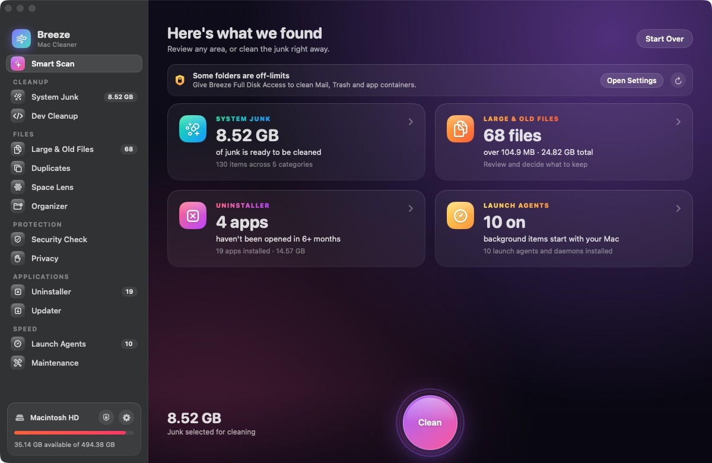
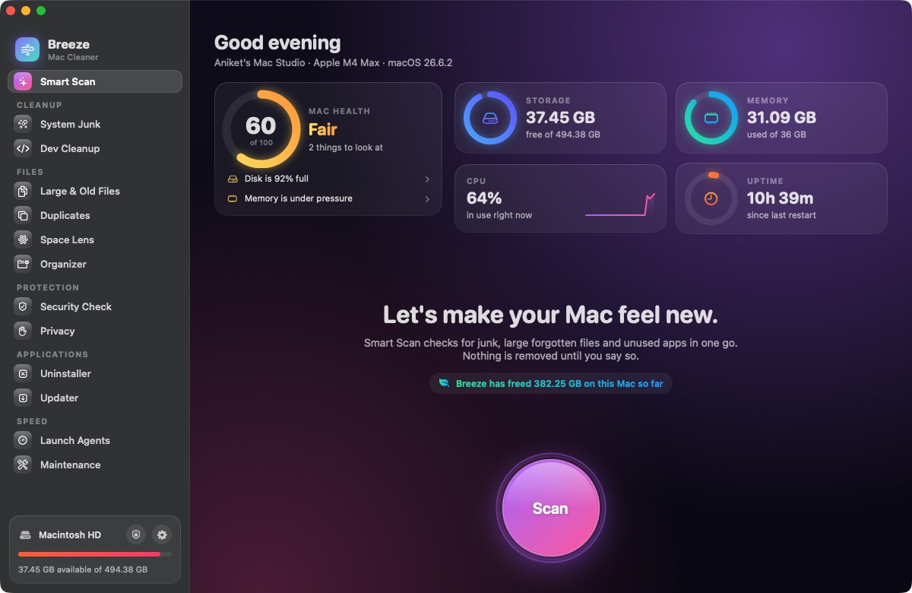
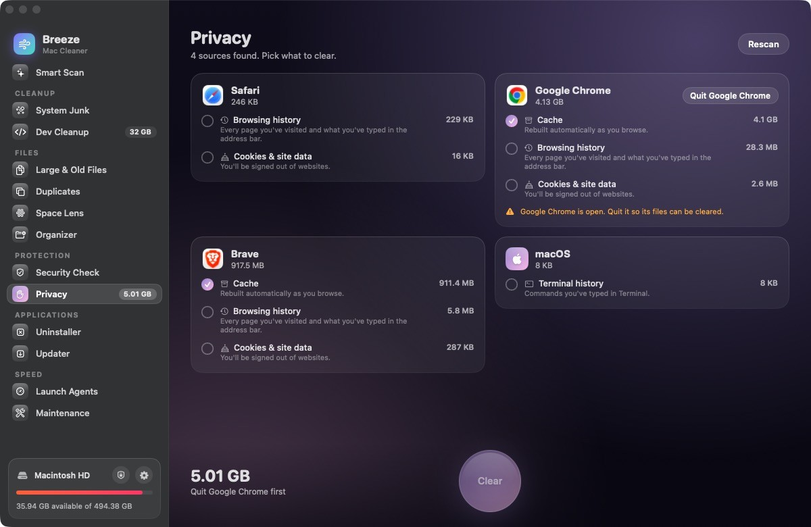
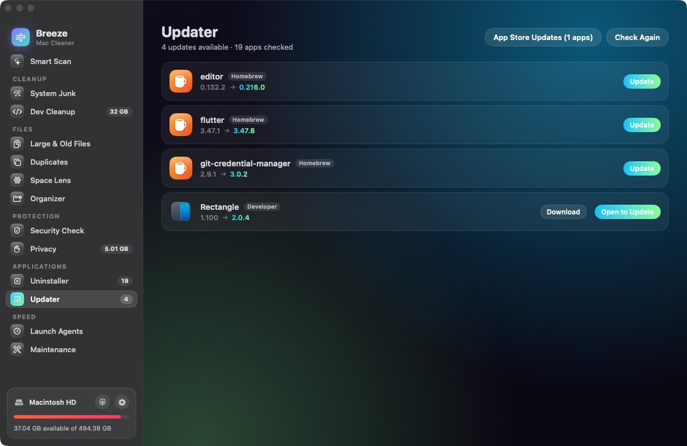

# Breeze: a native Mac cleaner

A free, open-source SwiftUI app for Macs running macOS 14 or later. It has no dependencies, no account and no telemetry. Everything runs locally; the only network requests are update checks (see [docs/PRIVACY.md](docs/PRIVACY.md)).

## Download

Get the signed, notarized DMG (Apple silicon and Intel) from [nanket.github.io/breeze](https://nanket.github.io/breeze/), or build it yourself as shown below.



<table>
  <tr>
    <td></td>
    <td></td>
    <td></td>
  </tr>
</table>

## Build & install

You need Xcode or the Command Line Tools (`xcode-select --install`). `build.sh` builds for Apple silicon; open `Breeze.xcodeproj` in Xcode for a universal build.

```bash
cd Breeze
./build.sh            # creates build/Breeze.app
./build.sh install    # also copies it to /Applications and opens it
```

The first build takes about a minute. After that you can open Breeze from Launchpad or Spotlight like any other app.

**Recommended:** give Breeze Full Disk Access so it can see Mail attachments, the Trash and app containers. Go to System Settings → Privacy & Security → Full Disk Access → **+** → Breeze. Breeze also has a button that opens this page. Each rebuild changes the app's ad-hoc signature, so you may need to toggle the permission off and on again after rebuilding.

## What it does

| Module | What it does |
|---|---|
| **Smart Scan** | Shows live storage, memory and uptime. Scans junk, large files, apps and background agents in one pass, then cleans the safe junk in one click. |
| **System Junk** | Finds user caches, logs, crash reports, Xcode DerivedData, device support and simulator caches. Also covers developer caches (npm, Gradle, Homebrew, CocoaPods, pip, Yarn, SwiftPM, Dart, Android, Unity, VS Code, Cursor), old `.dmg`/`.pkg` files in Downloads, Mail attachments, iOS backups, Xcode archives and the Trash. |
| **Dev Cleanup** | Finds `node_modules`, Pods, Gradle and Flutter builds, Python venvs, Rust targets and more, and flags the ones you haven't touched in 30 days. |
| **Large & Old Files** | Finds every file above a size you choose in your home folder. You can filter by type (videos, archives, disk images…) and by when you last opened it. |
| **Duplicates** | Compares file contents, not just names, and keeps one copy of each. |
| **Space Lens** | Draws any folder or the whole disk as an interactive map. Click a block to drill down, select items and send them to the Trash. |
| **Organizer** | Sorts a messy folder by type or month, with undo. |
| **Security Check** | Confirms Gatekeeper, FileVault, the firewall and XProtect are on, and flags unsigned apps and known adware. |
| **Privacy** | Clears browser caches, history and cookies for Safari, Chrome, Brave, Edge, Arc, Vivaldi and Firefox, with only caches selected by default. |
| **Uninstaller** | Lists every third-party app with its size, when you last opened it and whether it's unused. Removes the app together with its leftovers (preferences, caches, containers, saved state, launch agents). "Reset" wipes an app's data but keeps the app. |
| **Updater** | Checks each app's own update feed, Homebrew casks and the App Store. |
| **Launch Agents** | Shows the user and system launch agents and daemons, and which ones are running. You can remove the ones you don't want. |
| **Maintenance** | Runs one-click fixes: free up RAM, flush DNS, rebuild Launch Services, reset Quick Look, reindex Spotlight, thin Time Machine snapshots, clear font caches and restart the Dock and Finder. The tasks that need your password ask for it once. |

There's also a menu bar monitor with a low-disk warning and an optional weekly check-up.

## Safety

- **Nothing is removed until you press the button.** Each item has a checkbox, and only regenerable items are pre-selected. Installers in Downloads are only pre-selected once they're two weeks old.
- **Things that rebuild themselves are deleted straight away:** caches, logs, crash reports, browser data in Privacy, and build folders in Dev Cleanup (`node_modules`, Pods, `target` and so on, each with the command that restores it). Old simulators are removed with Xcode's own `simctl`.
- **Everything else goes to the Trash:** installers, large files, duplicates, apps and their leftovers, Mail attachments, backups, launch agents and Python venvs (which are never pre-selected, since they may hold packages installed by hand). To send caches and browser data to the Trash as well, turn on Settings → "Always use the Trash".
- **Your work is protected.** A built-in guard refuses macOS system folders, Keychains, SSH and GPG keys and iCloud Drive. IDE Local History (JetBrains and Android Studio keep it inside their cache folder) is kept when those caches are cleared.
- macOS-critical caches (iCloud, HomeKit, CloudKit, Safari Safe Browsing and others) are never touched. Apple's own apps are excluded from the Uninstaller, and uninstalling one app never picks up a sibling's files (Chrome vs Chrome Canary).
- Apps that are running are asked to quit before they're uninstalled or reset. If an app needs admin rights to remove, the Finder password prompt handles it. Emptying the Trash from the menu bar always asks first.

## Project layout

```
Sources/Breeze/
  App/BreezeApp.swift        app entry, window, menus
  Core/Theme.swift           colours, modules, gradients
  Core/Utilities.swift       sizing, trash/delete, shell, permissions
  Models/                    one @Observable model per module + scanners
  Views/                     SwiftUI screens and shared components
Resources/                   Info.plist + icon
build.sh                     compiles, bundles, signs and installs
```

## Support

Breeze is free. If it saved you some space, you can [leave a tip](https://aniketpure.gumroad.com/l/breeze) or star the repo. Bug reports and pull requests are welcome.

## Shipping

See **docs/RELEASE.md** for the release checklist and `scripts/release.sh` for the signed, notarized DMG build. The privacy policy and terms for the prebuilt app are in `docs/PRIVACY.md` and `docs/EULA.md`.

## License

Breeze is free software, released under the [GNU General Public License v3.0](LICENSE).
